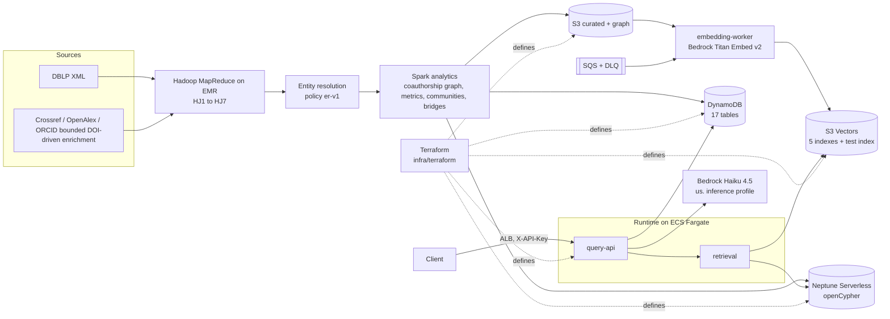

# ScholarChain

A Scala 3 scholarly-knowledge pipeline and evidence-grounded Graph-RAG service on AWS, built by a controlled team of Claude Code subagents under human gates.

> DRAFT status (Phase 17a). Everything that depends on the AWS phases (14 deploy, 15c experiments, 16 evaluation) is marked `[[PENDING-AWS: ...]]` or `[[PENDING-EVAL: ...]]`. Facts that need the author are marked `[[HUMAN: ...]]`. Every number below is cited to a committed file. Local tests, fixture demonstrations and AWS-validated real-data runs are kept separate: at the time of writing, **no AWS-validated run exists** (Phase 14 has not been accepted in this branch).

## Contents

1. [Identity](#1-identity)
2. [Problem statement](#2-problem-statement)
3. [Architecture summary](#3-architecture-summary)
4. [Agentic workflow summary](#4-agentic-workflow-summary)
5. [Required local software and version record](#5-required-local-software-and-version-record)
6. [AWS prerequisites](#6-aws-prerequisites)
7. [Environment variable names](#7-environment-variable-names)
8. [Format, compile, test, package](#8-format-compile-test-package)
9. [Bounded local sample](#9-bounded-local-sample)
10. [Terraform: format, validate, plan](#10-terraform-format-validate-plan)
11. [Automation scripts, deployment, bounded cloud pipeline, experiments, cleanup](#11-automation-scripts)
12. [API query examples](#12-api-query-examples)
13. [Runtime model (Bedrock only)](#13-runtime-model-bedrock-only)
14. [Agent catalog](#14-agent-catalog)
15. [Reproducing the agentic workflow](#15-reproducing-the-agentic-workflow)
16. [Phase table 00 to 17](#16-phase-table-00-to-17)
17. [Known limitations](#17-known-limitations)
18. [Final report, video, documentation links](#18-final-report-video-documentation-links)
19. [Deliverable index D01 to D20](#19-deliverable-index-d01-to-d20)

## 1. Identity

- Student: Dhruv Mehta (name as recorded in [docs/agent-runs/instructor-approvals.md](docs/agent-runs/instructor-approvals.md)).
- University email: `[[HUMAN: university email]]`
- Course: CS441 course project "ScholarChain" (the course specification is a read-only local file that is not part of this repository).
- Submission deadline: Wednesday, November 25, 2026 at 11PM CST (course specification, section "Submission logistics").
- Repository: private; instructor access and the submitted tag are `[[HUMAN: repository URL, instructor access, submitted tag]]`. No submitted tag is recorded in any committed file.

## 2. Problem statement

Scholarly knowledge about who collaborates with whom is spread over bibliographic sources that disagree about author identity, so questions such as "who has the most distinct coauthors in a field, how are two researchers connected, and which communities bridge" cannot be answered reliably from one source and cannot be trusted without evidence. ScholarChain acquires DBLP plus bounded Crossref, OpenAlex and ORCID enrichment, normalizes it with Hadoop MapReduce, resolves duplicate authors with an evaluated entity-resolution policy, builds a temporal coauthorship graph with Spark, loads it into Neptune, DynamoDB, S3 and S3 Vectors, and answers questions through a retrieval-augmented service in which every claim carries evidence IDs and an unsupported claim is rejected or labeled. Source: [modules/hadoop/JOB-CONTRACTS.md](modules/hadoop/JOB-CONTRACTS.md), [modules/entity-resolution/ER-CONTRACTS.md](modules/entity-resolution/ER-CONTRACTS.md), [modules/spark/SPARK-CONTRACTS.md](modules/spark/SPARK-CONTRACTS.md), [modules/storage/STORAGE-CONTRACTS.md](modules/storage/STORAGE-CONTRACTS.md), [modules/rag/RUNTIME-AGENTS.md](modules/rag/RUNTIME-AGENTS.md).

## 3. Architecture summary



Sources of every box: [docs/architecture.md](docs/architecture.md) (build-time and runtime diagrams with per-box source notes), [infra/terraform/INFRA-CONTRACTS.md](infra/terraform/INFRA-CONTRACTS.md) sections 4 to 6. The data path is traced in [docs/data-lineage.md](docs/data-lineage.md). Technology rationale is in [reports/final-report.md](reports/final-report.md) sections 7 to 14.

Modules (`build.sbt`, [CLAUDE.md](CLAUDE.md) "Module dependency boundaries"): `core` (shared contracts), `hadoop`, `entity-resolution`, `spark`, `storage`, `rag`, `services`. Project names in sbt are `core`, `hadoop`, `entityResolution`, `sparkAnalytics`, `storage`, `rag`, `services` (see [docs/agent-runs/phase-02-build-skeleton/prompt.md](docs/agent-runs/phase-02-build-skeleton/prompt.md)).

## 4. Agentic workflow summary

ScholarChain was generated by 18 project subagents defined under [.claude/agents/](.claude/agents/), each owning exactly the paths listed for it in [docs/agents.md](docs/agents.md) section 1. A human architect (the "orchestrator" session) writes a phase work order, dispatches the owning agent, dispatches test-engineer and code-reviewer where the phase record requires it, routes findings to the owner, and then ratifies or rejects the phase in a human gate. Subagents never invoke each other ([docs/agents.md](docs/agents.md) section 3). Hooks in [.claude/hooks/](.claude/hooks/) enforce the rules deterministically ([docs/agents.md](docs/agents.md) section 5). The evidence for every phase is under [docs/agent-runs/](docs/agent-runs/) (indexed in [docs/agent-runs-index-draft.md](docs/agent-runs-index-draft.md)). The definition of done is `sbt check`. See [section 15](#15-reproducing-the-agentic-workflow) to replay it.

## 5. Required local software and version record

Only versions that a committed file shows are stated; everything else is `[[HUMAN: version]]`.

| Tool | Version | Source |
|---|---|---|
| Claude Code client | 2.1.311 (phases 00 to 04: gates 00, 01, 02, 03 and 04), 2.1.323 (phases 07 to 10 and 15a gates); phases 05 and 06 `[[HUMAN: version]]` (the 05 gate records none, the 06 gate left its version line unfilled); phases 11 to 13, 15b and 17a `[[HUMAN: version]]` | [phase-00 gate](docs/agent-runs/phase-00-seed-agent/human-gate.md), [phase-01 gate](docs/agent-runs/phase-01-agent-factory/human-gate.md), [phase-02 gate](docs/agent-runs/phase-02-build-skeleton/human-gate.md), [phase-03 gate](docs/agent-runs/phase-03-contracts-datasets/human-gate.md), [phase-04 gate](docs/agent-runs/phase-04-hadoop-mapreduce/human-gate.md), [phase-07 gate](docs/agent-runs/phase-07-storage/human-gate.md), [phase-15a gate](docs/agent-runs/phase-15a-dataset-scale/human-gate.md) |
| Model configuration | orchestrator `claude-opus-5-5`; implementer agents `model: sonnet`; code-reviewer `model: opus`; factory-engineer `inherit` | [phase-01 gate](docs/agent-runs/phase-01-agent-factory/human-gate.md), [docs/agents.md](docs/agents.md) section 1 |
| JVM (tests, bytecode) | Temurin 17.0.21+9 for the forked test JVM; sbt itself ran on Homebrew JDK 27.0.1; bytecode `-release 17` | [phase-02 gate](docs/agent-runs/phase-02-build-skeleton/human-gate.md) |
| sbt | 2.0.12 | [project/build.properties](project/build.properties) |
| Scala | 3.3.9 (LTS); Scala 2.13.17 for Spark interop | [project/Versions.scala](project/Versions.scala) |
| Spark / Hadoop | 4.1.1 / 3.4.2 | [project/Versions.scala](project/Versions.scala) |
| AWS SDK for Java v2 | 2.59.7 | [project/Versions.scala](project/Versions.scala) |
| scalafmt | 3.11.5 | [project/Versions.scala](project/Versions.scala) |
| Terraform | `>= 1.9.0, < 2.0.0`; v1.17.2 printed on the authoring machine | [infra/terraform/INFRA-CONTRACTS.md](infra/terraform/INFRA-CONTRACTS.md) section 1 |
| Terraform AWS provider | `~> 6.73` (lock file pins 6.73.0) | same |
| trivy (config scan) | 0.76.2 | [infra/terraform/INFRA-CONTRACTS.md](infra/terraform/INFRA-CONTRACTS.md) section 11 |
| EMR release | `emr-spark-8.1.0` (fallback `emr-7.14.0` for MapReduce only) | same, sections 6 and 6.2 |
| Python | 3 (pytest version `[[PENDING-EVAL: replay output not yet committed]]`); `lxml`, `PyYAML`, `certifi` for dataset scripts | [phase-03 gate](docs/agent-runs/phase-03-contracts-datasets/human-gate.md); `python3 -m pytest --version` |
| AWS CLI | `[[HUMAN: version]]` (no committed file records it) | none |
| Docker | required for `sbt dockerLocal` and the MCP servers; version `[[HUMAN: version]]` | [build.sbt](build.sbt), [.mcp.json](.mcp.json) |
| shellcheck, jq, uv/uvx | `[[HUMAN: version]]` (required by `scripts/check.sh` and two MCP servers) | [scripts/check.sh](scripts/check.sh), [docs/agents.md](docs/agents.md) section 8 |

Local platform recorded in the gates: macOS arm64 ([phase-01 gate](docs/agent-runs/phase-01-agent-factory/human-gate.md)). Scripts target bash 3.2 or newer ([infra/terraform/INFRA-CONTRACTS.md](infra/terraform/INFRA-CONTRACTS.md) section 14).

## 6. AWS prerequisites

- An AWS account and a named profile; Region `us-east-2`, environment `course` ([infra/terraform/INFRA-CONTRACTS.md](infra/terraform/INFRA-CONTRACTS.md) section 1). Scripts refuse a caller whose account or Region differs from the Terraform variables. These documents do not record the AWS account ID.
- Terraform variables you must supply in a gitignored `infra/terraform/environments/course/terraform.tfvars` (copy [terraform.tfvars.example](infra/terraform/environments/course/terraform.tfvars.example), which contains dummy values only): `expected_account_id`, `owner`, `expiration_date`, `alert_email`, `alb_ingress_cidrs` (your own /32; `/0` is rejected by validation).
- Bedrock access in `us-east-2` to the Titan Text Embeddings V2 model and the Claude Haiku 4.5 `us.` inference profile (phase 11 gate records a 5-token Converse call that succeeded on 2026-11-24; end-to-end runtime acceptance is `[[PENDING-AWS: Phase 14 smoke test]]`).
- Read-only AWS access for the MCP server `aws-api` (a read-only IAM role named by `SCHOLARCHAIN_AWS_READONLY_PROFILE`, [docs/agents.md](docs/agents.md) section 8) is optional.
- Budget: $25 for the whole project including external APIs; the $25 budget is from [docs/agent-runs/instructor-approvals.md](docs/agent-runs/instructor-approvals.md); the human spend limit is $20 before credits ([phase-12 gate](docs/agent-runs/phase-12-terraform/human-gate.md) section 4, [infra/terraform/INFRA-CONTRACTS.md](infra/terraform/INFRA-CONTRACTS.md) section 10). Neptune and the load balancer are off by default (`create_neptune`, `create_alb`).
- Terraform apply and destroy are HUMAN-ONLY ([docs/agents.md](docs/agents.md) section 4).

## 7. Environment variable names

Names only. Secret values live in AWS Secrets Manager or in a mode-600 file outside the repository; nothing in this repository holds a value.

| Purpose | Names |
|---|---|
| AWS session | `AWS_PROFILE`, `AWS_REGION`, `SCHOLARCHAIN_AWS_READONLY_PROFILE` |
| Local test switches | `SCHOLARCHAIN_AWS_IT` (enables the live AWS suites; off by default), `SCHOLARCHAIN_JAVA_HOME`, `SCHOLARCHAIN_FACTORY_SESSION` (factory sessions only) |
| Storage (set by Terraform `app_environment`) | `SCHOLARCHAIN_ENVIRONMENT`, `SCHOLARCHAIN_AWS_REGION`, `SCHOLARCHAIN_STORAGE_RAW_BUCKET`, `SCHOLARCHAIN_STORAGE_CURATED_BUCKET`, `SCHOLARCHAIN_STORAGE_VECTOR_BUCKET`, `SCHOLARCHAIN_STORAGE_VECTOR_INDEX`, `SCHOLARCHAIN_STORAGE_DYNAMO_TABLE_PREFIX`, `SCHOLARCHAIN_STORAGE_NEPTUNE_ENDPOINT`, `SCHOLARCHAIN_STORAGE_NEPTUNE_BULK_LOAD_ROLE_ARN`, `SCHOLARCHAIN_STORAGE_NEPTUNE_BULK_LOAD_FORMAT`, `SCHOLARCHAIN_STORAGE_NEPTUNE_BULK_LOAD_SOURCE_S3_URI` |
| Models and embeddings | `SCHOLARCHAIN_MODELS_EMBEDDING_MODEL_ID`, `SCHOLARCHAIN_EMBEDDING_MODEL_ID`, `SCHOLARCHAIN_EMBEDDING_MODEL_DIMENSION`, `SCHOLARCHAIN_RAG_MODEL_PROVIDER`, `SCHOLARCHAIN_RAG_MODEL_BEDROCK_MODEL_ID` |
| Services | `SCHOLARCHAIN_SERVICES_PORT`, `SCHOLARCHAIN_SERVICES_RETRIEVAL_URL`, `SCHOLARCHAIN_SERVICES_EMBEDDING_QUEUE_URL`, `SCHOLARCHAIN_SERVICES_EMBEDDING_DLQ_URL`, `SCHOLARCHAIN_SERVICES_SYNC_DEADLINE_MILLIS`, `SCHOLARCHAIN_SERVICES_DOWNSTREAM_TIMEOUT_MILLIS`, `SCHOLARCHAIN_SERVICES_MAX_CONCURRENT_QUERIES`, `SCHOLARCHAIN_SERVICES_MAX_QUEUED_QUERIES` |
| Secrets (names of the variables injected from Secrets Manager) | `SCHOLARCHAIN_SERVICES_API_KEY`, `SCHOLARCHAIN_INTERNAL_API_KEY`; fallback-only and not used in the Bedrock-only deployment: `SCHOLARCHAIN_ANTHROPIC_API_KEY`, `SCHOLARCHAIN_VOYAGE_API_KEY` |
| Script inputs | `APPROVED_PLAN_SHA256`, `SC_SMOKE_API_KEY_FILE`, `SC_SMOKE_BASE_URL`, `SC_LOADTEST_API_KEY_FILE`, `SC_LOADTEST_BASE_URL`, `SC_LOADTEST_EXPECT_HOST`, `SC_LOADTEST_BENCHMARK`, `SC_RUN_ID`, `SC_EMR_INSTANCE_TYPE`, `SC_EMR_IDLE_TIMEOUT`, `SC_STEP_TIMEOUT`, `SC_SBT_TIMEOUT`, `SC_BUILD_TIMEOUT`, `SC_EXTRA_TAGS` |
| Dataset scripts | `SCHOLARCHAIN_CONTACT_EMAIL` (contact address for polite API use; read from the environment only), `OPENALEX_API_KEY` (optional) |

Sources: [infra/terraform/INFRA-CONTRACTS.md](infra/terraform/INFRA-CONTRACTS.md) sections 5, 9, 14; [modules/services/API.md](modules/services/API.md) "Configuration"; [scripts/](scripts/) headers; [experiments/README.md](experiments/README.md); [datasets/scripts/check_no_secrets.py](datasets/scripts/check_no_secrets.py) output. The rule that `ANTHROPIC_API_KEY` is rejected as a key-variable name is in [modules/rag/RUNTIME-AGENTS.md](modules/rag/RUNTIME-AGENTS.md) section 11 (L2).

## 8. Format, compile, test, package

All commands run from the repository root. The definition of done is the `check` alias in [build.sbt](build.sbt): `scalafmtCheckAll; scalafmtSbtCheck; Test/compile; Test/testFull; contractTest; markTestRun`.

```bash
sbt fmt                 # scalafmtAll; scalafmtSbt           (format)
sbt Test/compile        # compile main and test sources     (compile)
sbt check; echo "exit=$?" > .claude/.last-test-run     # canonical CHECK (format check, compile, all tests, contract tests, marker)
sbt contractTest        # Test/testOnly *ContractSuite       (contract tests only)
sbt packageJobs         # hadoop/assembly; sparkAnalytics/assembly   (Hadoop and Spark fat jars)
sbt dockerLocal         # services/servicesDockerBuild       (service image; needs Docker and SCHOLARCHAIN_GIT_SHA)
bash scripts/check.sh   # all non-cloud validation including sbt check (see section 11)
```

Observed results (not by this draft): the committed phase evidence records the canonical CHECK passing at each phase, for example 2,662 passed and 0 failed at Phase 11 ([docs/agent-runs/phase-11-adversarial-review/human-gate.md](docs/agent-runs/phase-11-adversarial-review/human-gate.md) section 2). **This draft did not run `sbt` (work order rule 0.3).** `sbt clean check` from a clean checkout is required at the final gate ([phase-02 gate](docs/agent-runs/phase-02-build-skeleton/human-gate.md) H3): `[[PENDING-EVAL: sbt clean check from a clean checkout]]`.

Python and shell tests (counts below are the ones recorded in committed gates; a fresh replay is not committed):

```bash
python3 -B -m pytest -p no:cacheprovider -q tests/datasets      # recorded: 149 Python dataset tests pass (15a gate section 2); fresh replay: [[PENDING-EVAL: replay output not yet committed]]
python3 -B -m pytest -p no:cacheprovider -q tests/experiments   # recorded: 131 passed (15b gate section 3); fresh replay: [[PENDING-EVAL: replay output not yet committed]]
bash scripts/tests/test-scripts.sh                              # recorded: passed=253 failed=0 (13 gate section 2); fresh replay: [[PENDING-EVAL: replay output not yet committed]]
```

## 9. Bounded local sample

The local sample is the 1,000-work DBLP selection plus cached enrichment under the gitignored `datasets/raw/`. These commands need data that is not in the repository (see [datasets/scripts/FETCH-SCALE.md](datasets/scripts/FETCH-SCALE.md) and the manifest [datasets/dataset-manifest.yaml](datasets/dataset-manifest.yaml)); they are **not replayed in this draft**. The exact commands are in the module contracts and were recorded as run in the phase reports:

| Stage | Command source | Recorded result |
|---|---|---|
| Hadoop HJ1 to HJ7 (local runner) | `PipelineDriver` command in [modules/hadoop/JOB-CONTRACTS.md](modules/hadoop/JOB-CONTRACTS.md) section 2; compare with `python3 -I modules/hadoop/tools/compare_roots.py <rootA> <rootB>` | rootI and rootI2 "ALL TABLES EQUAL" on 12 tables ([phase-05 gate](docs/agent-runs/phase-05-entity-resolution/human-gate.md) section 2) |
| Entity resolution tools | `entityResolution/runMain scholarchain.er.tools.*` in [modules/entity-resolution/ER-CONTRACTS.md](modules/entity-resolution/ER-CONTRACTS.md) | held-out researcher P 0.930, R 0.851, F1 0.889, n=90 ([modules/entity-resolution/evaluation/er-v1-results.md](modules/entity-resolution/evaluation/er-v1-results.md)) |
| Spark | `sparkAnalytics/Test/runMain scholarchain.spark.Run ...` and `...Compare` in [modules/spark/SPARK-CONTRACTS.md](modules/spark/SPARK-CONTRACTS.md) section 1 | sparkS1r2 and sparkS2r2 "ALL TABLES EQUAL" ([phase-06 gate](docs/agent-runs/phase-06-spark-analytics/human-gate.md)) |
| Storage local load | [modules/storage/STORAGE-CONTRACTS.md](modules/storage/STORAGE-CONTRACTS.md) section 8 | L4 and L5 identical, 63,121 DynamoDB items ([phase-07 gate](docs/agent-runs/phase-07-storage/human-gate.md)) |
| Embedding local run | [modules/storage/STORAGE-CONTRACTS.md](modules/storage/STORAGE-CONTRACTS.md) section 12, [modules/rag/RAG-EMBEDDING-CONTRACTS.md](modules/rag/RAG-EMBEDDING-CONTRACTS.md) | L3 and L4 byte-identical, 9,958 vectors with the deterministic local embedder ([phase-08 gate](docs/agent-runs/phase-08-embeddings-vectors/human-gate.md)) |
| Local API session | `sbt "services/runMain scholarchain.services.LocalSessionMain run-1"` ([modules/services/API.md](modules/services/API.md)) | scripted session run twice, response pairs identical ([phase-10 gate](docs/agent-runs/phase-10-services/human-gate.md) section 2) |

These are **local tests and local runs on real 1K data**, not AWS-validated runs. The bounded cloud sample is `bash scripts/run-bounded-pipeline.sh --scale 1k` ([section 11](#11-automation-scripts)): `[[PENDING-AWS: first EMR run]]`.

## 10. Terraform: format, validate, plan

```bash
terraform -chdir=infra/terraform fmt -check -recursive
terraform -chdir=infra/terraform/environments/course init -backend=false     # only when .terraform/ is absent (scripts/check.sh does this)
terraform -chdir=infra/terraform/environments/course validate
AWS_PROFILE=<profile> AWS_REGION=us-east-2 bash scripts/plan.sh               # read-only plan with checksum; human, own terminal
```

The Terraform commands above are the ones `scripts/check.sh` runs (see its header); none was run for this draft. The phase 12 plan (observed by the human, recorded in [docs/agent-runs/phase-12-terraform/human-gate.md](docs/agent-runs/phase-12-terraform/human-gate.md) section 1): exit code 2, 160 to add, 0 to change, 0 to destroy, plan SHA-256 `757331672f9fd90dd312c1f292d4d2a66891557c8913d36ea4a3d010f64af09b`. That plan is **superseded**: the phase 13 gate states a new plan after the merge items MERGE-1 and MERGE-2 will be recorded in the Phase 14 gate (`[[PENDING-AWS: Phase 14 plan SHA-256]]`). Security scan: trivy 0.76.2 reported 7 findings, all LOW, after repair round 2 ([infra/terraform/INFRA-CONTRACTS.md](infra/terraform/INFRA-CONTRACTS.md) section 11 item 8).

**HUMAN-ONLY (never run by an agent or a script; denied in [.claude/settings.json](.claude/settings.json)):**

```bash
AWS_PROFILE=<profile> terraform -chdir=infra/terraform/environments/course apply infra/terraform/plans/<base>.tfplan   # HUMAN-ONLY
terraform -chdir=infra/terraform/environments/course destroy                                                            # HUMAN-ONLY, see docs/runbook.md "Cleanup"
```

(Apply command from [INFRA-CONTRACTS.md](infra/terraform/INFRA-CONTRACTS.md) section 14.4 step 3; the destroy command is printed by `scripts/cleanup.sh` for the human.)

## 11. Automation scripts

All scripts live in [scripts/](scripts/), support `--help`, and none runs an apply or destroy (Phase 13 gate: shellcheck exit 0, harness `passed=253 failed=0`; [phase-13 gate](docs/agent-runs/phase-13-automation/human-gate.md) section 2). A fresh replay of the harness is not committed: [[PENDING-EVAL: replay output not yet committed]]. Real cloud behavior of every script below is `[[PENDING-AWS: Phase 14 and 15c runs]]`.

| Step | Command (from the repository root) | Who | Notes (source: script header) |
|---|---|---|---|
| Check (all non-cloud validation) | `bash scripts/check.sh [--skip-sbt] [--skip-terraform] [--skip-script-tests] [--env course] [--dry-run]` | anyone | agent files, JSON, hook syntax, script syntax, terraform fmt and validate, script harness, `sbt check` |
| Package | `bash scripts/package.sh [--allow-dirty] [--dry-run]` | deploy-engineer | fixed commands `sbt packageJobs`, `sbt dockerLocal`; clean tree required for a release record; pushes nothing |
| Plan | `AWS_PROFILE=<profile> bash scripts/plan.sh [environment]` | human | read-only; never applies |
| **Apply** | `terraform ... apply <saved plan>` | **HUMAN-ONLY** | see section 10 |
| Deploy | `APPROVED_PLAN_SHA256=<sha> AWS_PROFILE=<profile> AWS_REGION=us-east-2 bash scripts/deploy.sh --gate-file docs/agent-runs/<phase>/human-gate.md [--query-api-count 1] [--retrieval-count 1] [--worker-count 0] [--dry-run]` | deploy-engineer after a human apply | needs release artifacts from `package.sh`; the gate file must contain the approved plan SHA-256 |
| Smoke test | `SC_SMOKE_API_KEY_FILE=<mode-600 file outside the repo> AWS_PROFILE=<profile> AWS_REGION=us-east-2 bash scripts/smoke-test.sh [--allow-insecure-http] [--dry-run] [--print-key-help]` | deploy-engineer | `--allow-insecure-http` needed while the ALB is HTTP only; rotate the key afterwards ([phase-13 gate](docs/agent-runs/phase-13-automation/human-gate.md) decisions 1 and 2) |
| Bounded pipeline | `AWS_PROFILE=<profile> AWS_REGION=us-east-2 bash scripts/run-bounded-pipeline.sh --scale 1k\|10k\|50k [--approve-50k] [--stages hadoop,spark,load,enqueue] [--core-count 1\|2] [--run-id <token>] [--dry-run]` | deploy-engineer | `--smoke` is a separate invocation (`bash scripts/run-bounded-pipeline.sh --smoke`; the script refuses `--smoke` together with `--scale`); at most 3 EMR nodes (1 primary + at most 2 core/task), on-demand m5.xlarge, `TERMINATE_CLUSTER` on failure, 1-hour step limit; 50K refused without a successful 10K record and `--approve-50k`; load and enqueue stages exit 7 until M13-2 is resolved |
| Experiments | `bash scripts/run-experiment.sh <experiment-id> [--run-id <token>] [--dry-run]` (manifests in [experiments/manifests/](experiments/manifests/), order in [experiments/README.md](experiments/README.md)) | experiment-engineer, human approvals | manifest must have `"approved": true` and `approved_by` |
| Env window | `bash scripts/env-window.sh up` (prints human steps) / `bash scripts/env-window.sh down --yes` | human | `down` scales the three ECS services to 0 through the ECS API; Neptune and ALB off are printed human Terraform steps |
| Rollback | `AWS_PROFILE=<profile> AWS_REGION=us-east-2 bash scripts/rollback.sh --from-record <deployment.json> --reason "<text>" --approval-ref <file>` (or `--to-sha`, or `--revisions`) | deploy-engineer with recorded human approval | data and infrastructure untouched |
| Archive evidence | `bash scripts/archive-evidence.sh [--metrics-hours N] [--to-s3] [--dry-run]` | anyone | refuses to overwrite `reports/evidence/<sha>/` |
| Cleanup | `bash scripts/cleanup.sh [environment] [--empty-ecr --confirm-empty-ecr --gate-file <file>] [--no-aws] [--dry-run]` | **HUMAN-EXECUTED** (guard blocks agents) | lists, writes before/after inventories, prints the human commands; the only deletion it can do is emptying ECR images. Full procedure: [docs/runbook.md](docs/runbook.md) |

Deployment path, in order: [infra/terraform/INFRA-CONTRACTS.md](infra/terraform/INFRA-CONTRACTS.md) section 14.4 (the "Phase 14 apply checklist"), reproduced with failure handling in [docs/runbook.md](docs/runbook.md). No CI workflow exists (`.github/` is absent in this worktree); CI evidence is therefore not claimed.

Experiment reproduction: manifests A to F, caps and approval points are in [experiments/README.md](experiments/README.md); the manifests are checked by `python3 -B experiments/validate_manifests.py` (the 15b gate records `RESULT PASSED (0 problem(s))`); the per-manifest `cost_cap_usd` values in [experiments/manifests/](experiments/manifests/) are 3.00, 4.00, 1.00, 1.80, 1.20 and 0.80 USD for experiments A to F (sum 11.80 USD) and `model_cost_cap_usd` is per manifest (sum 1.85 USD, limit 2.00 USD per [experiments/README.md](experiments/README.md)). A fresh replay is not committed: [[PENDING-EVAL: replay output not yet committed]]. Results: `[[PENDING-AWS: Phase 15c raw results]]`.

## 12. API query examples

Request and response shapes: [modules/services/API.md](modules/services/API.md), [modules/core/REST-CONTRACTS.md](modules/core/REST-CONTRACTS.md), full route table in [docs/api-reference.md](docs/api-reference.md). Example body: [modules/core/src/main/resources/contracts/rest-query-request.example.json](modules/core/src/main/resources/contracts/rest-query-request.example.json).

```bash
# local mode (no AWS): scripted session, writes modules/services/target/local-run/<run>/transcript.json
sbt "services/runMain scholarchain.services.LocalSessionMain run-1"

# against a deployed query-api (needs the key file; see section 11). QUERY_API_URL is the Terraform output query_api_url.
KEY="$(cat "$SC_SMOKE_API_KEY_FILE")"    # key stays in a mode-600 file outside the repository; never paste it into a command
curl -sS -X POST "$QUERY_API_URL/v1/query" -H "X-API-Key: $KEY" -H "Idempotency-Key: demo-1" -H "Content-Type: application/json" \
  --data @modules/core/src/main/resources/contracts/rest-query-request.example.json
curl -sS "$QUERY_API_URL/v1/queries/<queryId>/evidence" -H "X-API-Key: $KEY"
curl -sS "$QUERY_API_URL/v1/evidence/<evidenceId>" -H "X-API-Key: $KEY"
curl -sS "$QUERY_API_URL/v1/explain/<queryId>" -H "X-API-Key: $KEY"
```

The local session is recorded as run twice with identical response pairs ([phase-10 gate](docs/agent-runs/phase-10-services/human-gate.md)); the deployed `curl` examples are `[[PENDING-AWS: first real query with evidence]]` (the `curl` lines above were not replayed). Passing the key on a command line is shown only for brevity of the example: [scripts/smoke-test.sh](scripts/smoke-test.sh) hands it to curl through a mode-600 header file instead.

## 13. Runtime model (Bedrock only)

Decision (human, [phase-11 gate](docs/agent-runs/phase-11-adversarial-review/human-gate.md) decision 1): the runtime uses Amazon Bedrock only. Answer model: Claude Haiku 4.5 through the US cross-region inference profile `us.anthropic.claude-haiku-4-5-20251001-v1:0`. Embeddings: Titan Text Embeddings V2, `amazon.titan-embed-text-v2:0`, 1024 dimensions. No Anthropic API and no Voyage cost is incurred.

Verification against committed configuration (read from the cited committed files), with mismatches reported rather than corrected:

| Item | Committed value | Source | Agrees with the decision? |
|---|---|---|---|
| Embedding model and dimension | `amazon.titan-embed-text-v2:0`, 1024 | [scholarchain-embedding.v1.conf](modules/core/src/main/resources/scholarchain-embedding.v1.conf), [variables.tf](infra/terraform/environments/course/variables.tf) line 132 | yes |
| Documented runtime override | `SCHOLARCHAIN_RAG_MODEL_PROVIDER=bedrock`, `SCHOLARCHAIN_RAG_MODEL_BEDROCK_MODEL_ID=us.anthropic.claude-haiku-4-5-20251001-v1:0` | [modules/services/API.md](modules/services/API.md) "Model and embedder selection" | yes (documentation only) |
| Core default | `bedrock-model-id = "us.anthropic.claude-sonnet-4-5-20250929-v1:0"` | [scholarchain-rag.v1.conf](modules/core/src/main/resources/scholarchain-rag.v1.conf) line 14 | **no**: the default is a Sonnet profile, so Terraform must set the override (merge item MERGE-1) |
| Terraform default `generation_model_id` | `anthropic.claude-haiku-4-5-20251001-v1:0` (bare model ID, not the `us.` profile) | [variables.tf](infra/terraform/environments/course/variables.tf) line 138 | **no**: and the variable is not read by the runtime ([API.md](modules/services/API.md) last bullet of that section) |
| Cost estimate | prices a model named `anthropic.claude-haiku-5-5` | [INFRA-CONTRACTS.md](infra/terraform/INFRA-CONTRACTS.md) section 10 | **no**: estimate and decision name different models |

MERGE-1 and MERGE-2 (Terraform sets the `rag.model.*` overrides and stops injecting the Anthropic and Voyage secrets) are recorded as pending in the [phase-11 gate](docs/agent-runs/phase-11-adversarial-review/human-gate.md) decision 2 and the [phase-12 gate](docs/agent-runs/phase-12-terraform/human-gate.md) G12-1/G12-2; their landing is `[[PENDING-AWS: verified in the Phase 14 plan and smoke test]]`. These mismatches are routed to infra-engineer (Terraform defaults, cost estimate) and the human (decision on the model named in the estimate); documentation-engineer does not change them.

## 14. Agent catalog

One row per file in [.claude/agents/](.claude/agents/) (18 files; `ls .claude/agents` lists 18; the validator's roster check is described in [.claude/hooks/validate-agent-files.sh](.claude/hooks/validate-agent-files.sh)). Purpose, owned paths and tool fence are taken from [docs/agents.md](docs/agents.md) section 1 and each agent's front matter; nothing here adds a rule. "Prerequisites" are what the committed files require before the agent is useful. Every agent ends with the 14 report fields of [docs/agents.md](docs/agents.md) section 10: `STATUS, OWNER, WORK ORDER, FILES CREATED, FILES MODIFIED, COMMANDS RUN, TEST RESULTS, VALIDATION RESULTS, ASSUMPTIONS, RISKS, MANUAL ACTION REQUIRED, BLOCKED-ON OWNER, BLOCKED-ON EVIDENCE, NEXT GATE`. The "CHECK" below means `sbt check; echo "exit=$?" > .claude/.last-test-run` (the only accepted way to write the marker, [docs/agents.md](docs/agents.md) section 7). The counts quoted for the Python and shell gates are the ones recorded in committed gates (section 8); a fresh replay is not committed. All other gates are quoted from the matrix and were not replayed here.

| Agent (model) | Purpose | Owned paths (docs/agents.md section 1) | Tool fence | Prerequisites | Example orchestrator instruction | Deterministic verification | Report fields |
|---|---|---|---|---|---|---|---|
| [factory-engineer](.claude/agents/factory-engineer.md) (inherit) | Creates and maintains the agent system; proposes constitutional diffs and never self-ratifies | `CLAUDE.md`, `docs/agents.md`, `.claude/**`, `.mcp.json` | Read, Grep, Glob, Write, Edit, Bash | human ratification then a fresh session; `SCHOLARCHAIN_FACTORY_SESSION=1` or `agent_type` in hook input to write constitutional files | `Use the factory-engineer agent to propose a diff for <constitutional change>.` | `.claude/hooks/validate-agent-files.sh` (expected exit 0 and `FAILURES: 0`; a fresh replay output is not committed), then human ratification | section 10 |
| [build-engineer](.claude/agents/build-engineer.md) (sonnet) | Owns the sbt multi-module build and the `check` alias | `build.sbt`, `project/**` except `project/Versions.scala`, `.scalafmt.conf`, `.gitignore`, `.sbtopts`, `.jvmopts`, compose files, `packaging/**` | Read, Grep, Glob, Write, Edit, Bash | JDK 17, sbt 2.0.12 | `Use the build-engineer agent to wire the <module> dependency in build.sbt.` | CHECK, code review | section 10 |
| [domain-engineer](.claude/agents/domain-engineer.md) (sonnet) | Shared domain records, stable IDs, serialization and configuration contracts | `modules/core/**` except `modules/core/src/test/**` | Read, Grep, Glob, Write, Edit, Bash | build skeleton (phase 02) | `Use the domain-engineer agent to add the <record> contract to core.` | CHECK (includes `contractTest`), code review | section 10 |
| [dataset-engineer](.claude/agents/dataset-engineer.md) (sonnet) | Dataset acquisition, sampling, manifest, licenses | `datasets/**` | Read, Grep, Glob, Write, Edit, Bash | python3 with lxml, PyYAML, certifi; network only for fetch scripts | `Use the dataset-engineer agent to validate the dataset manifest.` | `python3 -B datasets/scripts/validate_manifest.py` (the 15a gate records 355 checks passed, 0 failed); `python3 -B -m pytest -q tests/datasets` (the 15a gate records 149 passed) | section 10 |
| [hadoop-engineer](.claude/agents/hadoop-engineer.md) (sonnet) | Hadoop MapReduce jobs, counters, reject format | `modules/hadoop/**` except `modules/hadoop/src/test/**` | Read, Grep, Glob, Write, Edit, Bash | domain contracts; local DBLP selection under `datasets/raw/` | `Use the hadoop-engineer agent to fix <HJ job> as specified in modules/hadoop/JOB-CONTRACTS.md.` | CHECK; local run then `python3 -I modules/hadoop/tools/compare_roots.py <rootA> <rootB>` prints `ALL TABLES EQUAL` (not replayed: needs `datasets/raw/`) | section 10 |
| [entity-resolution-engineer](.claude/agents/entity-resolution-engineer.md) (sonnet) | Blocking keys, match features, thresholds, calibration, gold set | `modules/entity-resolution/**` except `modules/entity-resolution/src/test/**` | Read, Grep, Glob, Write, Edit, Bash | Hadoop outputs; human-authored gold labels | `Use the entity-resolution-engineer agent to evaluate the frozen er-v1 policy on the held-out split.` | CHECK; gold-set `Evaluate` tool ([ER-CONTRACTS.md](modules/entity-resolution/ER-CONTRACTS.md)); results at [er-v1-results.md](modules/entity-resolution/evaluation/er-v1-results.md) | section 10 |
| [spark-engineer](.claude/agents/spark-engineer.md) (sonnet) | Graph construction, analytics, evidence paths | `modules/spark/**` except `modules/spark/src/test/**` | Read, Grep, Glob, Write, Edit, Bash | ER decisions and Hadoop curated tables | `Use the spark-engineer agent to add <metric> to the Spark analytics.` | CHECK; `scholarchain.spark.Compare <rootA> <rootB>` prints `ALL TABLES EQUAL` (not replayed) | section 10 |
| [storage-engineer](.claude/agents/storage-engineer.md) (sonnet) | S3, Neptune, DynamoDB, S3 Vectors adapters and loaders | `modules/storage/**` except `modules/storage/src/test/**` | Read, Grep, Glob, Write, Edit, Bash | core ports; live suites need `SCHOLARCHAIN_AWS_IT=1` (not run) | `Use the storage-engineer agent to add <adapter behavior> per STORAGE-CONTRACTS.md.` | CHECK (live `*AwsItSuite` skipped unless `SCHOLARCHAIN_AWS_IT=1`) | section 10 |
| [rag-engineer](.claude/agents/rag-engineer.md) (sonnet) | Query plans, retrieval fusion, evidence bundles, prompts, claim verification | `modules/rag/**` except `modules/rag/src/test/**`, `prompts/**` | Read, Grep, Glob, Write, Edit, Bash | storage fakes; Bedrock only for live runs | `Use the rag-engineer agent to tighten claim verification for <case>.` | CHECK; 44-question benchmark ([RUNTIME-AGENTS.md](modules/rag/RUNTIME-AGENTS.md) section 9) | section 10 |
| [service-engineer](.claude/agents/service-engineer.md) (sonnet) | REST models, routes, health checks, runtime composition | `modules/services/**` except `modules/services/src/test/**` | Read, Grep, Glob, Write, Edit, Bash | rag and storage modules | `Use the service-engineer agent to add <route> to query-api per modules/core/REST-CONTRACTS.md.` | CHECK; `sbt "services/runMain scholarchain.services.LocalSessionMain run-1"` | section 10 |
| [test-engineer](.claude/agents/test-engineer.md) (sonnet) | Writes and runs tests, reports exact pass and fail | `tests/**`, `modules/*/src/test/**` | Read, Grep, Glob, Write, Edit, Bash | none beyond the module under test | `Use the test-engineer agent to add regression tests for <finding> and report exact pass and fail counts.` | CHECK; `python3 -B -m pytest -q tests/experiments` (the 15b gate records 131 passed) | section 10 |
| [code-reviewer](.claude/agents/code-reviewer.md) (opus) | Read-only verified verdict; returns a report, writes nothing | none (returns review reports as messages; the orchestrator stores them as `review-report.md`) | Read, Grep, Glob | the work order and the diff | `Use the code-reviewer agent to review the Phase <NN> change set read-only and return a verdict.` | none (no shell); verdict vocabulary from [.claude/agents/code-reviewer.md](.claude/agents/code-reviewer.md) step 4: "APPROVE-RECOMMENDED, CHANGES-REQUIRED, or BLOCKED" (the phase review reports used APPROVE / APPROVE WITH NOTES / REQUEST_CHANGES) | section 10 |
| [infra-engineer](.claude/agents/infra-engineer.md) (sonnet) | Terraform and operational scripts; plans only | `infra/terraform/**`, `scripts/**`, optional `.github/workflows/**` | Read, Grep, Glob, Write, Edit, Bash | Terraform, AWS CLI, trivy, shellcheck, jq | `Use the infra-engineer agent to add <resource> to the Terraform environment and produce a plan summary.` | `bash scripts/check.sh --skip-sbt`; `bash scripts/tests/test-scripts.sh` (the 13 gate records `passed=253 failed=0`); human reviews the plan | section 10 |
| [deploy-engineer](.claude/agents/deploy-engineer.md) (sonnet) | Executes approved deploy, rollback, bounded pipeline scripts and records them | `reports/deployments/**` | Read, Grep, Glob, Write, Bash (no Edit) | human-applied approved plan, recorded in a human gate | `Use the deploy-engineer agent to run /deploy for env course with the plan approved in docs/agent-runs/<phase>/human-gate.md.` | `bash scripts/smoke-test.sh` and the rollback gate ([docs/agents.md](docs/agents.md) section 2 phase 14); `[[PENDING-AWS: not run]]` | section 10 |
| [experiment-engineer](.claude/agents/experiment-engineer.md) (sonnet) | Experiment manifests, collectors, load tests, immutable raw results | `experiments/**`, `load-tests/**` | Read, Grep, Glob, Write, Edit, Bash | approved manifest; AWS only in approved windows | `Use the experiment-engineer agent to run exp-a-baseline-10k from its approved manifest.` | `python3 -B experiments/validate_manifests.py` (the 15b gate records `RESULT PASSED (0 problem(s))`); `python3 -B -m pytest -q tests/experiments` | section 10 |
| [documentation-engineer](.claude/agents/documentation-engineer.md) (sonnet) | README, docs, final report, diagrams, demo script | `README.md`, `docs/**` except `docs/agents.md`, `docs/agent-runs/**`, `docs/incidents/**`, `reports/final-report.md`, `docs/diagrams/**`, `docs/demo-script.md` | Read, Grep, Glob, Write, Edit, Bash | committed evidence | `Use the documentation-engineer agent to update the README from verified repository state.` | link check and command replay (see "Documentation link check" below), then reviewer evidence review | section 10 |
| [incident-responder](.claude/agents/incident-responder.md) (sonnet) | Diagnoses incidents, records them, runs only human-approved rollback and bounded recovery | `docs/incidents/**` | Read, Grep, Glob, Write, Edit, Bash | a deployed environment; human approval recorded | `Use the incident-responder agent to diagnose incident <id> in env course: <symptom>.` | human escalation for data, security or destructive actions; no incident record exists yet `[[PENDING-AWS: incident exercise]]` | section 10 |
| [dependency-updater](.claude/agents/dependency-updater.md) (sonnet) | Version values in the ledger and update reports | `project/Versions.scala`, `reports/dependency-updates/**` | Read, Grep, Glob, Write, Edit, Bash | none | `Use the dependency-updater agent to bump <dependency> to <version> and write the update report.` | CHECK, vulnerability review, code review | section 10 |

Commands (human-started only, `disable-model-invocation: true`, [docs/agents.md](docs/agents.md) section 6): `/deploy`, `/rollback`, `/incident`, `/run-pipeline`, `/experiment`, defined in [.claude/commands/](.claude/commands/).

Tool-use rules are enforced by the hooks listed in [docs/agents.md](docs/agents.md) section 5: [guard-dangerous.sh](.claude/hooks/guard-dangerous.sh), [guard-writes.sh](.claude/hooks/guard-writes.sh), [format-scala.sh](.claude/hooks/format-scala.sh), [verify-tests-ran.sh](.claude/hooks/verify-tests-ran.sh), and the manual validator [validate-agent-files.sh](.claude/hooks/validate-agent-files.sh). MCP servers ([.mcp.json](.mcp.json); names only, trust boundaries in [docs/agents.md](docs/agents.md) section 8): `github` (needs Docker and `GITHUB_PERSONAL_ACCESS_TOKEN` from the user's environment), `aws-api` (needs `uvx` and a read-only profile), `terraform` (Docker), `aws-docs` (`uvx`). They were not enabled during Phase 01 ([phase-01 gate](docs/agent-runs/phase-01-agent-factory/human-gate.md) disclosures). Graders verify availability with `docker --version`, `uvx --version` and the validator's MCP-server checks.

Documentation link check (the documentation-engineer gate; no link-check script is committed; the check was an ad-hoc script whose result is in the documentation report, not in a committed file): every relative link target in README.md, docs/ and reports/final-report.md must exist.

## 15. Reproducing the agentic workflow

Prerequisite reading: [CLAUDE.md](CLAUDE.md), [docs/agents.md](docs/agents.md), [docs/agent-runs/README.md](docs/agent-runs/README.md) (human-owned) and the draft index [docs/agent-runs-index-draft.md](docs/agent-runs-index-draft.md).

1. **Clone the private repository and check out the submitted tag.**
   ```bash
   git clone <private repository URL> ScholarChain && cd ScholarChain
   git checkout <submitted tag>
   ```
   `[[HUMAN: repository URL and submitted tag]]` (no tag exists in this worktree).
2. **Install the documented Claude Code version and the toolchain** of [section 5](#5-required-local-software-and-version-record): Claude Code 2.1.323 (the version recorded most often; `claude --version` should print it; `[[HUMAN: confirm replay version]]`), Temurin JDK 17, sbt 2.0.12, python3, Docker, Terraform, AWS CLI, jq, shellcheck, uv.
3. **Configure only the required environment variables and read access.** Export `JAVA_HOME` (and `SCHOLARCHAIN_JAVA_HOME`) for Temurin 17. For cloud replay add `AWS_PROFILE`, `AWS_REGION=us-east-2` and, for the MCP servers, `GITHUB_PERSONAL_ACCESS_TOKEN` (fine-grained, read-only) and `SCHOLARCHAIN_AWS_READONLY_PROFILE`. Never put a secret in the repository: `python3 -B datasets/scripts/check_no_secrets.py` scans for it. Do not export `SCHOLARCHAIN_FACTORY_SESSION=1` except for a factory-engineer phase ([docs/agents.md](docs/agents.md) section 5).
4. **Start Claude Code from the repository root:** `claude`.
5. **Confirm everything is loaded or discoverable:** `ls .claude/agents` lists 18 files; `ls .claude/hooks .claude/commands`; `cat .claude/settings.json`; `cat .mcp.json`; the `/hooks` command in Claude Code lists the hooks (Phase 01 probe 2 recorded "6 hooks on 4 events", [phase-01 gate](docs/agent-runs/phase-01-agent-factory/human-gate.md)). `CLAUDE.md` imports `docs/agents.md` (the validator checks this import).
6. **Run the safe agent validation and the dangerous-command probe.**
   ```bash
   .claude/hooks/validate-agent-files.sh      # expected: exit 0 and a summary line "FAILURES: 0" (fresh replay output not committed: [[PENDING-EVAL: replay output not yet committed]])
   ```
   Dangerous-command probe (inside the Claude Code session, as recorded in [phase-01 gate](docs/agent-runs/phase-01-agent-factory/human-gate.md) probes 3 and 4): ask the orchestrator to run a shell `echo` whose text contains the phrase "terraform destroy" (expected: blocked by `guard-dangerous.sh`), and to read `.env` (expected: denied by the permission rules). The probe is **not replayed in this draft** (the guard would block the documentation agent's own shell call), so the recorded result is `PASS` from the Phase 01 evidence only.
7. **Replay a phase.** Open a fresh session or `/clear`, copy the exact work order from `docs/agent-runs/phase-NN-<name>/prompt.md`, and tell the orchestrator to use the named owning subagent, for example `Use the build-engineer agent to ...` (the prompt files already begin with that instruction). The owner of each phase is in [docs/agents.md](docs/agents.md) section 2.
8. **After the owner returns, invoke test-engineer or code-reviewer exactly when the phase record requires it** (the phase's `test-report.md` and `review-report.md` show which; [docs/agents.md](docs/agents.md) section 3: code-reviewer reviews implementation and test-engineer reports pass and fail before a phase can be accepted).
9. **Route BLOCKED-ON findings through the orchestrator** to the artifact owner named in `BLOCKED-ON OWNER`; never edit another owner's files directly ([docs/agents.md](docs/agents.md) section 3). The orchestrator reruns the blocked agent in a fresh context after the owner's repair.
10. **Compare the reproduced report, tests and diff with the archived evidence** in the phase folder (`agent-report.md`, `review-report.md`, `test-report.md`, `repair-*.md`, `commit.txt`). Wording is not expected to be identical; artifacts, contracts, tests, safety gates and observable results are.
11. **Use a fresh session before the next phase**, so the ratified repository state, not stale conversation context, is the starting point. The orchestrator records the human decision in `human-gate.md` and the commit in `commit.txt`; the human commits ([CLAUDE.md](CLAUDE.md) "No self-approval").

### Bounded reproduction exercise (no cloud)

Phase 02 (build skeleton) is the smallest code-generation phase: its evidence shows it created 14 files, 715 insertions (`git show --stat 04a455d`). Replay it on a branch from its parent commit and compare with the archived evidence.

```bash
# 1. Agent validation (expect exit 0, FAILURES: 0)
.claude/hooks/validate-agent-files.sh
# 2. Branch at the commit before Phase 02 was accepted (04a455d^ = b415ff2, "phase-01 evidence: record accepted commit hash")
git show 04a455d:docs/agent-runs/phase-02-build-skeleton/prompt.md > "$TMPDIR/phase-02-prompt.md"
git switch -c replay/phase-02 b415ff2
# 3. Fresh Claude Code session: paste "$TMPDIR/phase-02-prompt.md" (it begins "Use the build-engineer agent to create the ScholarChain sbt multi-project build ...")
#    The orchestrator dispatches build-engineer, dependency-updater (ledger) and, for the smoke test, domain-engineer and test-engineer,
#    then code-reviewer, exactly as recorded in docs/agent-runs/phase-02-build-skeleton/agent-report.md.
# 4. Deterministic gate
sbt check; echo "exit=$?" > .claude/.last-test-run
cat .claude/.last-test-run
# 5. Compare with the archived evidence
git diff --stat 04a455d -- build.sbt project .scalafmt.conf modules/core
diff <(git show 04a455d:project/Versions.scala) project/Versions.scala
```

Expected observable result (archived: [phase-02 agent-report](docs/agent-runs/phase-02-build-skeleton/agent-report.md)): `sbt check` ends with `[success]` and the marker reads `exit=0`; `CoreContractSuite` passes 2 of 2. The Phase 02 gate documents that the first review returned REQUEST_CHANGES for a literal image tag outside the ledger and that the repair moved it into `project/Versions.scala` ([phase-02 gate](docs/agent-runs/phase-02-build-skeleton/human-gate.md)). **This exercise was not replayed in this draft** (it needs a fresh Claude Code session, and `sbt` was out of scope for this work order): `[[PENDING-EVAL: grader or human replay of the Phase 02 exercise]]`.

A pure-Python exercise that needs no Claude session and no sbt, with the counts recorded in committed gates (section 8): `python3 -B datasets/scripts/validate_manifest.py`, `python3 -B experiments/validate_manifests.py`, `bash scripts/tests/test-scripts.sh`.

## 16. Phase table 00 to 17

Status values come from each phase's `human-gate.md`; hashes from `commit.txt` (first seven characters; Phase 02 has no `commit.txt`, its hash is from `git log`); test counts from the gate or report cited in [docs/agent-runs-index-draft.md](docs/agent-runs-index-draft.md), which also holds the reviewer verdicts.

| Phase | Work (docs/agents.md section 2) | Status | Accepted commit | Tests recorded |
|---|---|---|---|---|
| 00 | Plant the seed agent | accepted after 1 repair | `9f6ea14` | n/a |
| 01 | Agent factory | accepted (ratified) after 2 repairs | `2d9f06d` | 7 probes pass; no source yet |
| 02 | Build and repository skeleton | accepted (ratified) | `04a455d` (git log; no commit.txt) | CoreContractSuite 2 of 2 |
| 03 | Contracts, configuration, dataset manifests | accepted after 2 repairs | `71b8dd7` | 307 passed (sbt) |
| 04 | Raw ingestion and Hadoop MapReduce | accepted | `e157892` | 638 passed |
| 05 | Entity resolution | accepted | `5dd0ed6` | 1,125 passed |
| 06 | Temporal coauthorship graph and Spark analytics | accepted | `609ea21` | 1,513 passed |
| 07 | Storage adapters and loading | accepted | `d423d53` | 1,791 passed |
| 08 | Embeddings and S3 Vectors ingestion path | accepted | `70472ea` | 2,118 passed |
| 09 | Runtime collaboration-analysis agents | accepted | `40a461d` | 2,423 passed |
| 10 | REST microservices | accepted (3 fixes routed to phase 11) | `189f0b8` | 2,555 passed |
| 11 | Adversarial testing and full review | accepted with notes | `0bd4a29` | 2,662 passed |
| 12 | AWS infrastructure in Terraform | approved (plan only; apply deferred) | `5edd031` | no sbt pass recorded in gate; plan 160 add, 0 change, 0 destroy |
| 13 | Build, deployment, experiment automation | accepted with notes | `3115aa3` | shell harness 253 passed, 0 failed |
| 14 | Apply and deploy through human approval | `[[PENDING-AWS: lane 1, not in this branch]]` | `[[PENDING-AWS]]` | `[[PENDING-AWS]]` |
| 15a | Dataset scale (10K and 50K subsets) | accepted | `d1ee169` | 149 Python tests; `sbt check` exit 0 (count not recorded) |
| 15b | Experiment harness | accepted with notes | `9710421` | 131 Python tests; `sbt check` exit 0 |
| 15c | Pipeline and elasticity runs | `[[PENDING-AWS]]` | `[[PENDING-AWS]]` | `[[PENDING-AWS]]` |
| 16 | Evaluation | `[[PENDING-EVAL]]` | `[[PENDING-EVAL]]` | `[[PENDING-EVAL]]` |
| 17 | Documentation, final review, release | draft 17a only (this file set) | `[[PENDING]]` | `[[PENDING-EVAL: final sbt clean check, release manifest]]` |

## 17. Known limitations

Each is recorded in a human gate or contract; see [reports/final-report.md](reports/final-report.md) section 23 and its Disclosures for the full list and sources.

- No AWS-validated run exists yet: every result is a local test, a fixture demonstration or a local run on real 1K data. Live AWS suites (`*AwsItSuite`) are written and not run ([phase-07 gate](docs/agent-runs/phase-07-storage/human-gate.md) section 8).
- Entity resolution: held-out researcher n=90 and work n=5 (3 matches, 0 non-matches), single human labeler; LLM adjudication was not executed; work-kind precision cannot be measured ([modules/entity-resolution/evaluation/er-v1-results.md](modules/entity-resolution/evaluation/er-v1-results.md), [phase-05 gate](docs/agent-runs/phase-05-entity-resolution/human-gate.md)).
- Venue and affiliation are not persisted upstream; no `AFFILIATED_WITH` edges exist, so institution questions have no affiliation data ([phase-05 gate](docs/agent-runs/phase-05-entity-resolution/human-gate.md) section 7, [modules/rag/RUNTIME-AGENTS.md](modules/rag/RUNTIME-AGENTS.md) section 11).
- Paper vectors at 1K scale are title-level text only ([phase-08 gate](docs/agent-runs/phase-08-embeddings-vectors/human-gate.md) decision 4).
- OpenSearch is not implemented (optional tier, [phase-07 gate](docs/agent-runs/phase-07-storage/human-gate.md) section 2).
- The ALB serves plain HTTP; the smoke test needs `--allow-insecure-http` ([phase-13 gate](docs/agent-runs/phase-13-automation/human-gate.md) decision 2).
- The load and embedding-enqueue stages of `run-bounded-pipeline.sh` have no EMR entry point yet (merge item M13-2, [INFRA-CONTRACTS.md](infra/terraform/INFRA-CONTRACTS.md) section 14.3).
- The graph-only and vector-only retrieval modes are refused with 422 by the service as built ([modules/services/API.md](modules/services/API.md), [experiments/README.md](experiments/README.md) row E).
- Bridge analysis reports cross-community degree, participation coefficient and communities touched; approximate betweenness was not computed ([phase-06 agent-report](docs/agent-runs/phase-06-spark-analytics/agent-report.md)).
- Phase 00 `agent_report.md` and `repair-01.md` are empty files, and Phase 02 has no `commit.txt` (evidence gaps, [docs/agent-runs-index-draft.md](docs/agent-runs-index-draft.md)).

## 18. Final report, video, documentation links

- Final report (draft): [reports/final-report.md](reports/final-report.md)
- Demonstration video: `[[HUMAN: video URL]]`; script: [docs/demo-script.md](docs/demo-script.md)
- Architecture: [docs/architecture.md](docs/architecture.md); data lineage: [docs/data-lineage.md](docs/data-lineage.md); threat model: [docs/threat-model.md](docs/threat-model.md); limits: [docs/service-limits.md](docs/service-limits.md); runbook (including cleanup): [docs/runbook.md](docs/runbook.md); evaluation: [docs/evaluation.md](docs/evaluation.md); API: [docs/api-reference.md](docs/api-reference.md)

## 19. Deliverable index D01 to D20

"Present" means the path exists in this worktree. "Pending" means it depends on phases not yet accepted; the placeholder says which.

| ID | Deliverable | Where | State |
|---|---|---|---|
| D01 | Private Git repository | this repository; tags and instructor access `[[HUMAN: tag, instructor access]]` | partial: history present, no tag |
| D02 | Agentic constitution | [CLAUDE.md](CLAUDE.md), [docs/agents.md](docs/agents.md), [.claude/agents/](.claude/agents/), [.claude/settings.json](.claude/settings.json), [.claude/hooks/](.claude/hooks/), [.claude/commands/](.claude/commands/), [.mcp.json](.mcp.json); version record in [section 5](#5-required-local-software-and-version-record) (some entries `[[HUMAN: version]]`); invocation instructions in [section 14](#14-agent-catalog) | present |
| D03 | Agent run evidence | [docs/agent-runs/](docs/agent-runs/); index draft [docs/agent-runs-index-draft.md](docs/agent-runs-index-draft.md) | present with gaps (Phase 00 empty report files, Phase 02 no commit.txt, commit.txt of Phases 11, 12, 13 and 15b holds a short hash) |
| D04 | Deterministic build | [build.sbt](build.sbt), [project/](project/), [.scalafmt.conf](.scalafmt.conf), `sbt check` | present; `sbt clean check` from a clean checkout `[[PENDING-EVAL]]` |
| D05 | Dataset package | [datasets/dataset-manifest.yaml](datasets/dataset-manifest.yaml), [datasets/schemas/](datasets/schemas/), [datasets/samples/](datasets/samples/), [datasets/scripts/](datasets/scripts/) | present (15a gate records the manifest validator at 355 checks passed, 0 failed) |
| D06 | Hadoop package | [modules/hadoop/](modules/hadoop/), [JOB-CONTRACTS.md](modules/hadoop/JOB-CONTRACTS.md) | present; EMR run `[[PENDING-AWS]]` |
| D07 | Entity-resolution package | [modules/entity-resolution/](modules/entity-resolution/), [ER-CONTRACTS.md](modules/entity-resolution/ER-CONTRACTS.md), [gold/](modules/entity-resolution/gold/), [evaluation/](modules/entity-resolution/evaluation/) | present; LLM adjudication not executed |
| D08 | Spark package | [modules/spark/](modules/spark/), [SPARK-CONTRACTS.md](modules/spark/SPARK-CONTRACTS.md) | present (local 1K run); bounded EMR results `[[PENDING-AWS]]` |
| D09 | Storage package | [modules/storage/](modules/storage/), [STORAGE-CONTRACTS.md](modules/storage/STORAGE-CONTRACTS.md) | present; live behavior `[[PENDING-AWS]]`; OpenSearch not implemented |
| D10 | Runtime collaboration-analysis package | [modules/rag/](modules/rag/), [RUNTIME-AGENTS.md](modules/rag/RUNTIME-AGENTS.md), [prompts/](prompts/) | present; live model behavior `[[PENDING-AWS]]` |
| D11 | Microservices package | [modules/services/](modules/services/), [API.md](modules/services/API.md), [docs/api-reference.md](docs/api-reference.md) | present; authentication is one API key (single-tenant) |
| D12 | Terraform package | [infra/terraform/](infra/terraform/), [INFRA-CONTRACTS.md](infra/terraform/INFRA-CONTRACTS.md) | present; archived plan to match deployed state `[[PENDING-AWS]]` |
| D13 | Reproducibility automation package | [scripts/](scripts/) (11 scripts, 3 libraries, harness); CI workflow: none | present; CI evidence none |
| D14 | Deployment package | `reports/deployments/` (deploy-engineer) | `[[PENDING-AWS: Phase 14 release manifest, image digests, smoke tests, rollback evidence]]` |
| D15 | Experiment package | [experiments/](experiments/), [load-tests/](load-tests/) | harness present; raw metrics, plots, elasticity and failure run `[[PENDING-AWS: Phase 15c]]` |
| D16 | Evaluation package | [docs/evaluation.md](docs/evaluation.md), [experiments/evaluation/](experiments/evaluation/) scaffolding; ER evaluation present | `[[PENDING-EVAL: Phase 16]]` for the other six groups |
| D17 | Documentation package | this README, [docs/architecture.md](docs/architecture.md), [docs/data-lineage.md](docs/data-lineage.md), [docs/threat-model.md](docs/threat-model.md), [docs/service-limits.md](docs/service-limits.md), [docs/runbook.md](docs/runbook.md), [docs/evaluation.md](docs/evaluation.md), [docs/api-reference.md](docs/api-reference.md) | draft present |
| D18 | Final report | [reports/final-report.md](reports/final-report.md) | draft present; results `[[PENDING-AWS]]`/`[[PENDING-EVAL]]` |
| D19 | Demonstration video | script [docs/demo-script.md](docs/demo-script.md) | `[[HUMAN: recorded video URL]]`; AWS shots `[[PENDING-AWS]]` |
| D20 | Cleanup evidence | procedure [docs/runbook.md](docs/runbook.md); `reports/cleanup/` inventories | `[[PENDING-AWS: inventory before and after, retained-state explanation]]` |

Release manifest (commit SHA, image digests, plan checksum, dataset snapshots, run IDs, prompt versions, model versions, test counts, artifact checksums): `[[PENDING-AWS: Phase 17 release manifest]]`.
