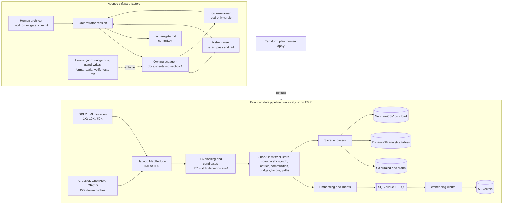
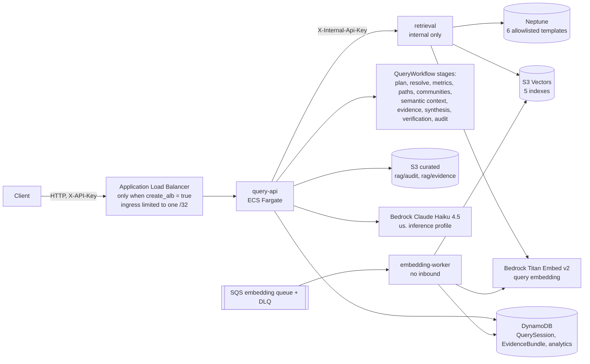

# ScholarChain architecture

Draft (Phase 17a). Status of each part is stated per diagram. Nothing here was observed on AWS; the AWS side is the Terraform design in [infra/terraform/INFRA-CONTRACTS.md](../infra/terraform/INFRA-CONTRACTS.md) (authored and statically validated; a plan was produced for the Phase 12 gate, no apply is recorded in this branch). `[[PENDING-AWS: deployed-state confirmation, Phase 14]]`.

## 1. Build-time architecture (data pipeline and the agent factory)

Sources: Hadoop jobs HJ1 to HJ7 and their mapping to the specification jobs: [modules/hadoop/JOB-CONTRACTS.md](../modules/hadoop/JOB-CONTRACTS.md) section 1. Spark outputs and invariants: [modules/spark/SPARK-CONTRACTS.md](../modules/spark/SPARK-CONTRACTS.md) sections 3 to 10. Neptune CSV, DynamoDB tables, S3 Vectors and the queue: [modules/storage/STORAGE-CONTRACTS.md](../modules/storage/STORAGE-CONTRACTS.md) sections 3, 4, 5, 7 and 12. Orchestration rules: [docs/agents.md](agents.md) sections 3 and 5. EMR bounds (1 primary plus at most 2 core/task nodes, on-demand m5.xlarge, `TERMINATE_CLUSTER` on a failed step, 1-hour step limit): [INFRA-CONTRACTS.md](../infra/terraform/INFRA-CONTRACTS.md) sections 6 and 14.2 and the header of [scripts/run-bounded-pipeline.sh](../scripts/run-bounded-pipeline.sh).

Status of each stage (evidence class in parentheses):

| Stage | State |
|---|---|
| HJ1 to HJ7 | local runs on the real 1K selection plus cached enrichment (local tests / local real-data run); EMR `[[PENDING-AWS]]` |
| Spark | local `local[*]` runs on 1K (local real-data run); EMR `[[PENDING-AWS]]` |
| Loaders | local file output and in-memory fakes only; the bulk load into Neptune and the DynamoDB writes `[[PENDING-AWS]]`; `run-bounded-pipeline.sh` load and enqueue stages have no EMR entry point (M13-2) |
| Embedding worker | fake queue and deterministic local embedder (fixture); Bedrock `[[PENDING-AWS]]` |

### Module dependency boundaries

`core` is depended on by every module and depends on none. `hadoop`, `entity-resolution`, `spark`, `storage`, `rag` and `services` must not form cycles; `services` composes `rag` and `storage` at runtime; no module depends on `services` ([CLAUDE.md](../CLAUDE.md)). One edge was added with human approval in Phase 05: `hadoop` depends on `entityResolution` ([phase-05 gate](agent-runs/phase-05-entity-resolution/human-gate.md) decision 1); the CLAUDE.md wording was not updated (constitutional, deferred).

## 2. Runtime architecture (query path)

Sources: services, roles, ports and exposure: [INFRA-CONTRACTS.md](../infra/terraform/INFRA-CONTRACTS.md) section 5; routes, limits and the model and embedder selection: [modules/services/API.md](../modules/services/API.md); stages and guarantees: [modules/rag/RUNTIME-AGENTS.md](../modules/rag/RUNTIME-AGENTS.md) sections 1 to 3; the six graph templates: [STORAGE-CONTRACTS.md](../modules/storage/STORAGE-CONTRACTS.md) section 3.5. In AWS mode query-api reaches graph, vector and embedding reads only through retrieval and has no Neptune client ([API.md](../modules/services/API.md) "Services"). The retrieval security group accepts ingress only from the query-api group ([INFRA-CONTRACTS.md](../infra/terraform/INFRA-CONTRACTS.md) section 5).

The audit location is the curated bucket under `rag/audit/` (Phase 11 fix, [phase-11 gate](agent-runs/phase-11-adversarial-review/human-gate.md) section 2).

Status: the AWS composition code compiles and a dry start with a tripwire credentials provider was tested; it has never executed against AWS ([phase-10 gate](agent-runs/phase-10-services/human-gate.md) section 4, [phase-11 gate](agent-runs/phase-11-adversarial-review/human-gate.md) section 2). Local mode (in-memory stores, graph store over the local Neptune CSVs, deterministic embedder, fake model client) is what the 44-question benchmark and the API tests exercise (fixture / local tests).

## 3. Infrastructure view

| Layer | Design | Source |
|---|---|---|
| Network | one VPC, 2 AZs, public subnets for Fargate and EMR, private subnets for Neptune, S3 and DynamoDB gateway endpoints, no NAT gateway, no interface endpoints | [INFRA-CONTRACTS.md](../infra/terraform/INFRA-CONTRACTS.md) section 2 |
| Compute | ECS Fargate 0.25 vCPU / 512 MiB; desired count 0 at creation; autoscaling maximum 4 per service | section 5 |
| Pipeline compute | EMR created per run by `scripts/run-bounded-pipeline.sh`, never more than 3 nodes; a Step Functions state machine `scholarchain-pipeline` documents the same shape | sections 6 and 14.2 |
| Stores | 5 S3 buckets, 17 DynamoDB tables (on-demand), Neptune Serverless (1 to 2.5 NCU, off by default), S3 Vectors bucket with 6 indexes, 2 SQS queues | section 4 |
| Identity | per-service ECS execution roles and task roles, EMR service and instance roles, Step Functions role; no customer-managed KMS key | section 3 |
| Observability | CloudWatch dashboard `scholarchain-overview`, 3 alarms, 7-day log retention, budget `scholarchain-budget` $25 monthly | section 7 |

Plan summary recorded by the human: 160 resources to add, 0 to change, 0 to destroy; 20 IAM creates; Neptune off; ALB off ([phase-12 gate](agent-runs/phase-12-terraform/human-gate.md) section 1). This plan is superseded by a post-merge plan.

## 4. Why these technologies (short; full argument in the final report)

See [reports/final-report.md](../reports/final-report.md) sections 7 to 15 for the reasoning per technology. The course requires Hadoop MapReduce for the initial processing, Spark for graph analytics, Neptune, DynamoDB and S3 Vectors as stores (course specification, section "Minimum acceptance criteria", items 3 to 7). The explanations in the final report of why each fits (keyed record transformations with counters, DataFrame windows for graph metrics, parameterized openCypher templates, conditional writes, vector metadata with source pointers) are the documentation author's reading of the module contracts, not separately recorded human decisions; each cites its contract file.
