# Data lineage

Draft (Phase 17a). The lineage below is traced from committed contracts and phase evidence. The counts quoted come from the committed local runs on the 1,000-work DBLP selection (local real-data runs). No AWS run has produced any lineage record yet: `[[PENDING-AWS: lineage of the 10K and 50K runs, Phase 15c]]`.

## 1. Overview

```mermaid
flowchart LR
  S1[DBLP XML selection<br/>datasets/dataset-manifest.yaml] --> H1[HJ1 DblpExtractJob]
  S2[Crossref / OpenAlex / ORCID envelopes<br/>DOI-driven caches] --> H2[HJ2 SourceNormalizeJob]
  H1 --> H3[HJ3 ExactIdentifierJob]
  H2 --> H3
  H1 --> H4[HJ4 teams, authorship, pair candidates]
  H3 --> H5[HJ5 GraphCandidateExportJob<br/>curated tables]
  H4 --> H5
  H5 --> H6[HJ6 entity views, blocks, candidates]
  H6 --> H7[HJ7 MatchDecisionJob<br/>policy er-v1]
  H7 --> SP[Spark Run: identity clusters,<br/>graph, metrics, communities, bridges, paths]
  H5 --> SP
  SP --> P[Parquet scholarchain-graph/*<br/>load-manifests/*]
  P --> L[Storage loaders]
  L --> N[(Neptune openCypher CSV)]
  L --> D[(DynamoDB analytics tables)]
  P --> E[Embedding documents<br/>S3 text + textHash]
  E --> V[(S3 Vectors)]
  N --> A[Runtime: graph templates]
  D --> A
  V --> A
  A --> EV[Evidence bundle<br/>evidence IDs, text hashes]
  EV --> ANS[Answer claims verified<br/>against evidence]
  ANS --> AU[Audit record rag/audit/]
```

## 2. Stage by stage

| Stage | Inputs (with identity) | Output | Provenance recorded | Source |
|---|---|---|---|---|
| Source selection | `dblp.xml` (gitignored, ~5.4 GB, hash recorded in the manifest), seed 441 selection rules, DTD | `dblp-1k`, `dblp-10k`, `dblp-50k` selections and extracted XML subsets | manifest entries with counts, SHA-256, seed, selector version; 10K XML 5,778,232 B, 50K XML 28,530,861 B | [datasets/dataset-manifest.yaml](../datasets/dataset-manifest.yaml); [phase-15a gate](agent-runs/phase-15a-dataset-scale/human-gate.md) section 2 |
| Enrichment | DOIs of the selected works; Crossref, OpenAlex, ORCID public APIs | cached JSON envelopes (gitignored) with `retrieved_at` and checksum | per-envelope retrieval time and checksum; ORCID record-level data is never committed | [datasets/scripts/FETCH-SCALE.md](../datasets/scripts/FETCH-SCALE.md); [phase-03 gate](agent-runs/phase-03-contracts-datasets/human-gate.md) decision 8 |
| Hadoop HJ1 to HJ5 | selection XML, DTD, enrichment trees | curated tables: works, mentions, authorship, teams, pair candidates, exact-identifier evidence, institutions, topics, rejects (`reject-v1`) | `PipelineRunManifest` with input checksums, code version, parameters; run ID `Ids.runId("hadoop-pipeline", codeVersion, attempt, config, inputs)`; rejects link by `runId`, `jobId`, `sourceRecordId` or `inputByteOffset` | [JOB-CONTRACTS.md](../modules/hadoop/JOB-CONTRACTS.md) sections 3 and 5; 1K run: works 8,295, authorship 3,928, teams 1,000, pair candidates 8,420, 0 rejects ([phase-04 gate](agent-runs/phase-04-hadoop-mapreduce/human-gate.md) section 2) |
| Hadoop HJ6, HJ7 | entity views from works and mentions | blocks, candidates, `MatchDecisionV2` (accepted, rejected, unresolved, conflict) | `er.*` settings, `featureSetVersion`, `leftSource`, `rightSource`, decision epoch from configuration (no clock) | [ER-CONTRACTS.md](../modules/entity-resolution/ER-CONTRACTS.md); 1K run: 2,191 decisions (999 accepted, 712 rejected, 470 unresolved, 10 conflict) ([er-v1-results.md](../modules/entity-resolution/evaluation/er-v1-results.md)) |
| Spark | Hadoop curated tables and the final decisions file | `scholarchain-graph/<table>/` Parquet (identity clusters, researchers, works, coauthor edges with the full edge-to-work table, metrics, components, communities, bridges, coreness, paths, temporal changes, semantic summaries), `run-manifest.json`, `load-manifests/*.json` | row-level `provenance` JSON string (inputs with checksums, code version, parameters, run ID); 26 `_provenance.json` files; run ID `run:fa55dff8...` for the 1K run | [SPARK-CONTRACTS.md](../modules/spark/SPARK-CONTRACTS.md) sections 4, 8, 9; [phase-06 agent-report](agent-runs/phase-06-spark-analytics/agent-report.md) |
| Storage load | Spark output and load manifests | Neptune CSV (vertices and edges), DynamoDB items, S3 objects under `<prefix><name>/run=<hex>/` with `manifest.json` and SHA-256 per object | each Neptune row carries `loadRunId`, `sparkRunId`, `provenanceDigest`; the full provenance sits once in `load-manifest.json`; 32 files per local load; 63,121 DynamoDB items | [STORAGE-CONTRACTS.md](../modules/storage/STORAGE-CONTRACTS.md) sections 2 to 4; [phase-07 gate](agent-runs/phase-07-storage/human-gate.md) section 2 |
| Embedding | Spark `semantic-summaries` (entity ID, document type, `textHash`, text) | text objects in S3 (`rag/text/<sha256>.txt`) and vectors in 5 indexes; metadata holds `textHash`, `textS3Uri`, `embeddingModelId`, `embeddingModelVersion`, `runId`; long text never in metadata | idempotent by text hash and model version; per-key claims table; RunLedger attempts and failures | [STORAGE-CONTRACTS.md](../modules/storage/STORAGE-CONTRACTS.md) sections 5.2 and 12; local run: 9,958 documents, 9,958 vectors ([phase-08 gate](agent-runs/phase-08-embeddings-vectors/human-gate.md) section 2) |
| Retrieval | question, plan, resolved researcher IDs | graph rows (six allowlisted templates, parameters only), metric rows with run and metric version, semantic hits | model calls store hashes and counts, never prompt or output text | [RUNTIME-AGENTS.md](../modules/rag/RUNTIME-AGENTS.md) sections 2 and 3; [RUNTIME-CONTRACTS.md](../modules/core/RUNTIME-CONTRACTS.md) |
| Evidence | stage outputs | evidence bundle: graph facts and metrics kept separate from semantic context; each item with an evidence ID, source dataset and record, snapshot, score, provenance with a `sha256:` text hash | stored in `EvidenceBundle` (spilled to S3 above 300,000 bytes) and under `evid#` / `qevid#` keys | [API.md](../modules/services/API.md) "Stored items"; [STORAGE-CONTRACTS.md](../modules/storage/STORAGE-CONTRACTS.md) section 4 |
| Answer | evidence bundle | typed claims, each with evidence IDs and a verification status (verified, partially supported, unsupported, conflicting); unsupported claims are rejected or labeled | audit documents at `rag/audit/<hash>/<hash>.json` in the curated bucket; prompt and schema SHA-256 per query | [RUNTIME-AGENTS.md](../modules/rag/RUNTIME-AGENTS.md) section 3; [prompts/README.md](../prompts/README.md); [phase-11 gate](agent-runs/phase-11-adversarial-review/human-gate.md) section 2 |

## 3. Tracing one answer back to its source (procedure)

1. `GET /v1/queries/{queryId}/evidence` lists the evidence items of the answer; `GET /v1/evidence/{evidenceId}` gives the source dataset, source record, snapshot and `sha256:` text hash; `GET /v1/explain/{queryId}` gives the plan, query templates, indexes, prompt versions and model IDs ([API.md](../modules/services/API.md)).
2. A metric evidence item names the Spark run ID and metric version; the `coauthor-edge-works` table lists every joint work behind an edge; the work ID points to the Hadoop `works` table and its `PipelineRunManifest` (input checksums).
3. The `PipelineRunManifest` names the DBLP selection and the enrichment trees by checksum; those match the manifest entries in [datasets/dataset-manifest.yaml](../datasets/dataset-manifest.yaml).

Steps 1 to 3 were exercised only against local fixtures (the end-to-end API test reaches an answer whose cited evidence IDs all resolve: [phase-10 gate](agent-runs/phase-10-services/human-gate.md) section 2). `[[PENDING-AWS: the same trace on the deployed system with a real query, Phase 14]]`.

## 4. Known gaps in lineage

- Venue and affiliation are not persisted by Phase 04; `AFFILIATED_WITH`, `DERIVED_FROM` and `SUPPORTED_BY` edges are absent, so institution vertices have no incident edge ([phase-07 gate](agent-runs/phase-07-storage/human-gate.md) decision 3).
- `RejectRecord` carries no provenance field by contract; it links by run ID only ([phase-04 gate](agent-runs/phase-04-hadoop-mapreduce/human-gate.md) decision 3).
- Real-run labels such as `74eee4e+repair04` separate run IDs but are not content addresses ([phase-05 gate](agent-runs/phase-05-entity-resolution/human-gate.md) decision 4).
- The 10K and 100K selections and the DBLP index cache are stale under selection-rules version 2 until the approved reindex; the 10K and 50K selections were re-checked and 0 of 10,000 and 0 of 50,000 are ineligible ([phase-03 gate](agent-runs/phase-03-contracts-datasets/human-gate.md) risks; [phase-15a gate](agent-runs/phase-15a-dataset-scale/human-gate.md) decision 2).
